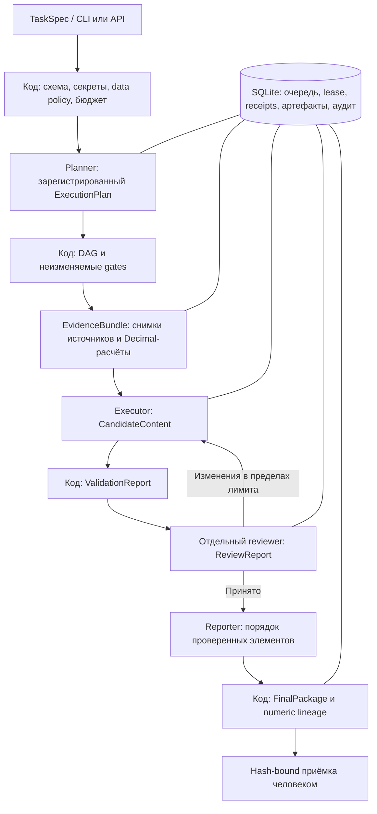

# Архитектура и границы v0.1

`application/contracts.py` определяет внешние и межэтапные объекты. JSON Schema экспортируется командой `schemas`. Неизвестные поля отклоняются. Некоторые поля настроек имеют явные безопасные значения по умолчанию; бизнес-цель, источники, ограничения и критерии приёмки обязательны.

`config.py` отделяет роли от моделей. Жёсткие фильтры применяются до сравнения кандидатов. Среди квалифицированных кандидатов приоритет имеют меньшая ожидаемая стоимость принятого результата, затем задержка. Это входные оценки из eval, а не статистика, автоматически выдуманная системой. Fallback проходит те же фильтры; для исправления формата после исчерпания повторов нужна квалифицированная модель более высокого tier. Переход на другое семейство не доказывает независимость ошибок.

`engine.py` выполняет зарегистрированный конечный процесс. В v0.1 поддержан один фиксированный DAG; граф модели проверяется топологически и сравнивается с разрешённым профилем. Этапы не выполняются параллельно, потому что в этом профиле зависят друг от друга. Добавление независимых ветвей требует расширения зарегистрированного workflow, контрактов и тестов. Роль reader здесь исполняет код: он получает уже переданные материалы, не скачивает произвольные URL.

`storage.py` хранит состояние и артефакты в одной SQLite-базе с WAL, foreign keys и synchronous FULL. Контент, метаданные, parent IDs и checkpoint узла фиксируются одной транзакцией. SHA-256 вычисляется по каноническому JSON. Артефакты не имеют операции изменения; исправления создают новый узел итерации. Проверка хеша обнаруживает повреждение, но не является криптографической подписью против администратора, который может переписать и данные, и хеши.

Перед запросом сохраняется reservation. После ответа сохраняется нормализованный receipt: разрешённый финальный текст, usage, фактический model ID из ответа, завершение и request ID. Сырые reasoning/thinking-блоки не становятся артефактом. При повторном запуске receipt повторно валидируется и используется без нового запроса. Потерянный запрос с неизвестным результатом остаётся зарезервированным; повтор может привести к дополнительной оплате провайдеру.

Lease действует 15 секунд и продлевается каждые 3 секунды. Только владелец действующего lease может резервировать вызовы и фиксировать результаты. После hard crash другой worker забирает истёкший lease. Это защита от случайных конкурирующих процессов на одном хранилище, а не распределённая система высокой доступности. Хранение SQLite на сетевой файловой системе не поддерживается.

TaskSpec и конфигурация сохраняются снимками при submit. Также фиксируются хеши кода/схем, Python/platform, версии основных зависимостей и lock-файла. При изменении кода или схем текущий workflow не продолжает генерацию автоматически: нужен явный перенос состояния либо новый run. Replay выполняет текущие программные проверки и сообщает несовместимость; он не обещает эмулировать любую старую версию Python.

`api.py` использует ту же устойчивую очередь, а не неперсистентный FastAPI BackgroundTask. Локальный bearer token даёт доступ ко всем run этой инсталляции. Понятия отдельных пользователей и tenants отсутствуют. CLI доверяет правам текущего пользователя ОС.

Новый предметный профиль должен регистрировать контракты, разрешённые tools, DAG, программные gates и эталонные негативные примеры. Произвольный текст входного документа не считается регистрацией профиля. Профиль quant research не активирован: его данные, backtester, holdout и методология должны быть определены отдельно.
